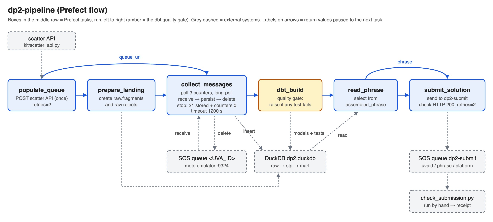
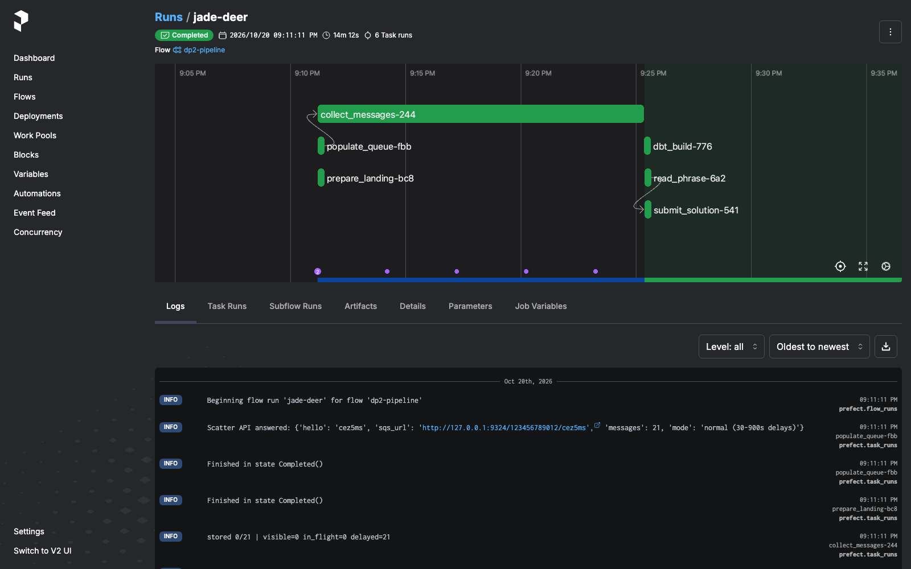
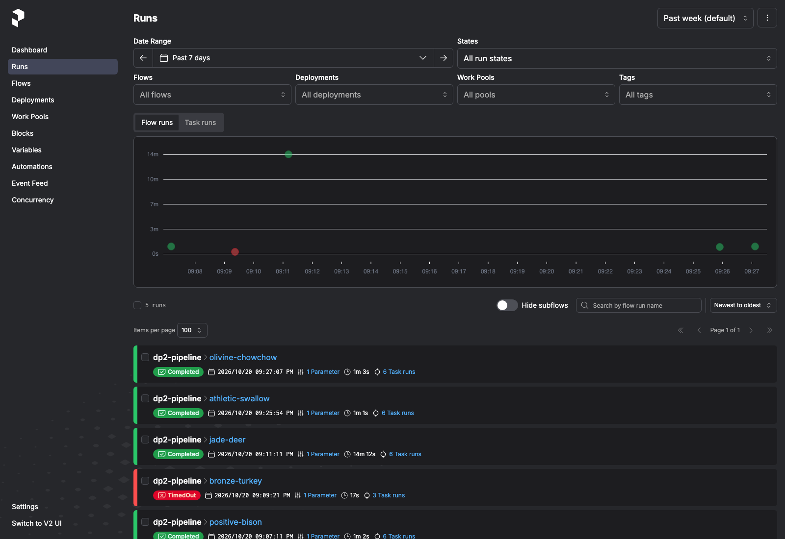
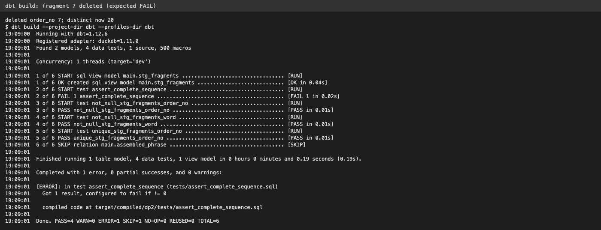
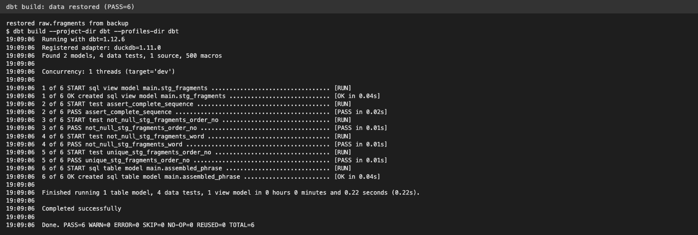

# DS 3022 Data Project 2: The SQS Puzzle

Receipt code: `FBCA14E44A`

My Prefect flow POSTs to the scatter API, collects the 21 messages from my queue, saves each fragment in DuckDB before deleting the message, builds the phrase with dbt (the tests have to pass first), and submits it to `dp2-submit`.

## Setup and running

I used Python 3.13 on a Mac.

```bash
python3 -m venv .venv
source .venv/bin/activate
pip install -r requirements.txt
pip install "fastapi>=0.139,<0.140"
cp .env.example .env
```

Set `UVA_ID` in `.env` to your computing ID.

Note on fastapi: pip installed fastapi 0.156 for me and `prefect server start` crashed with `TypeError: Body() got an unexpected keyword argument 'min_items'`. Installing fastapi 0.139 fixed it.

Then open four terminals (activate the venv in each, run from the repo folder):

- T1: `moto_server -p 9324`
- T2: `python kit/scatter_api.py`
- T4: `prefect config set PREFECT_API_URL="http://127.0.0.1:4200/api"` then `prefect server start`
- T3: `python kit/smoke_test.py` (should say `Emulator OK`), then:

```bash
python prefect-flow.py
python kit/check_submission.py
```

To switch modes change `DP2_FAST` / `DP2_CHAOS` in `.env` and restart T2.

## DAG



populate_queue -> prepare_landing -> collect_messages -> dbt_build -> read_phrase -> submit_solution. `populate_queue` returns the queue URL that `collect_messages` uses, and `read_phrase` returns the phrase that `submit_solution` sends. After the flow I run `check_submission.py` by hand.

`populate_queue` and `submit_solution` have `retries=2` since they're network calls. The retry on `populate_queue` can only happen if the POST itself fails, which is before any collecting starts, so it can't re-scatter in the middle of a run. `dbt_build` has no retries because a failed test is a data problem, not a glitch.

## Polling strategy

I monitor and collect in one loop in `collect_messages`. Each pass it checks how many distinct fragments are stored in DuckDB and the three queue counters (visible, in flight, delayed), and logs them. It stops when 21 distinct fragments are stored and all three counters are 0. Otherwise it calls `receive_message` with up to 10 messages and `WaitTimeSeconds=10` (long polling), so it waits for messages instead of sleeping. Empty responses are handled with `resp.get("Messages", [])`.

There's a 1200 s timeout since the max delay is 900 s. If it runs out it raises `TimeoutError: Only X/21 fragments after 1200 s`. I tested this with `timeout_s=15` and got `TimeoutError: Only 7/21 fragments after 15 s`, and dbt and submit didn't run.

What I didn't do:
- `sleep(900)` and then read everything: always wastes time and still breaks if something is late.
- Stop after 21 received messages: breaks with duplicates, which is why I count distinct order_no and check the counters.
- Monitor first and then collect: that was my Checkpoint A version (`monitor_queue` is still in the file), but it's slower since it waits for all delays before receiving anything.

## Receive -> persist -> delete

Each message gets inserted into `raw.fragments` first and deleted second. If the flow crashes after saving but before deleting, the message comes back after the visibility timeout and gets saved twice, but `distinct` in the staging model and in the stop count handles that. If I deleted first and crashed before saving, that fragment would be lost for good. `prepare_landing` recreates the tables at the start of each run because each POST starts a new puzzle.

## Chaos round

In chaos mode the scatter API sends 24 messages: the 21 fragments, 2 duplicates and 1 poison message with `order_no='?'` and no `word`.

What broke: my Session 10 code read `a["word"]["StringValue"]` directly, so the poison message crashed it with `KeyError: 'word'`. Just skipping it wouldn't work either, because if it's not deleted it keeps coming back and in_flight never goes to 0.

Fix: I added `parse()` which returns None if an attribute is missing or `order_no` isn't a number. Bad messages get logged as a warning and saved in `raw.rejects`, good ones go in `raw.fragments`, and the message gets deleted either way. Duplicates count once because of `count(distinct order_no)` and `select distinct`.

I ran it twice in a row and both passed. From the second run:

```
Scatter API answered: {..., 'messages': 24, 'mode': 'fast (5-60s delays) + CHAOS'}
WARNING Rejected malformed message 432237df-3bf2-4fe6-af1f-d7ba4811bd98
stored 21/21 | visible=0 in_flight=0 delayed=0
Done. PASS=6 WARN=0 ERROR=0 SKIP=0 NO-OP=0 REUSED=0 TOTAL=6
Submitted, HTTP 200
PASS  cez5ms / prefect  receipt: FBCA14E44A
```

DuckDB after each run: 23 rows in `raw.fragments`, 21 distinct order_no, 1 row in `raw.rejects`.

## Tool roles

- Prefect runs the tasks in order, does the retries, stops the flow when something fails, and gives me logs and the dashboard. Without it I'd just have a script with no retries or run history.
- DuckDB is where fragments are saved before the message is deleted, so nothing is lost if the flow crashes. Without it everything would be in memory.
- dbt casts order_no to an integer (so 10 comes after 2), removes duplicates, builds the phrase, and its tests are the gate (`not_null`, `unique` on order_no, and a test for exactly 21 fragments with no gaps). Without it a wrong phrase could get submitted.

## Results

Full-delay run (`DP2_FAST=0`), Completed in 14m 12s:



All my runs, including the timeout test and the two chaos runs:



dbt test failing on purpose (deleted order_no 7):



And passing again after restoring the data:



Receipt: `FBCA14E44A`
