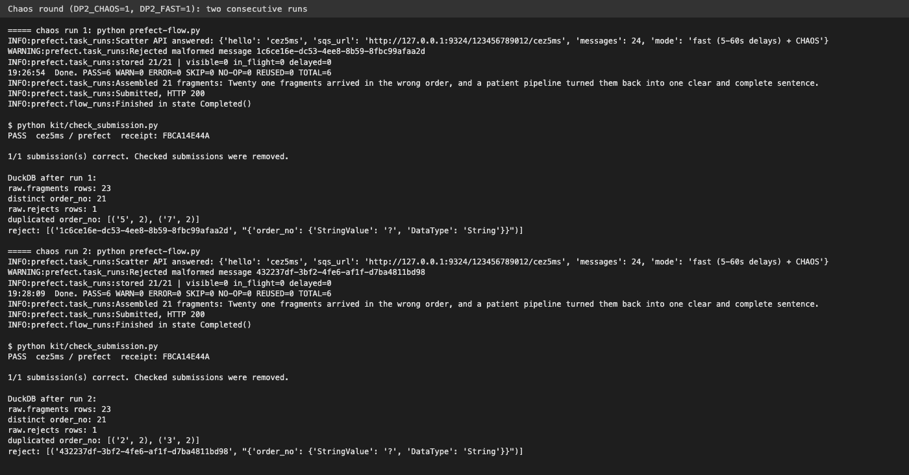

# DS 3022 Data Project 2: The SQS Puzzle

My Prefect pipeline for Data Project 2. It POSTs to the scatter API, collects the 21 delayed messages from my SQS queue (local Moto emulator), lands every fragment in DuckDB before deleting its message, rebuilds the phrase with dbt (tests are the gate), and submits the phrase to `dp2-submit`.

**Receipt code:** `FBCA14E44A` (check it with `python kit/check_submission.py --verify cez5ms prefect FBCA14E44A`)

## 1. Setup and how to run it

I used Python 3.13 on macOS (3.12 also works).

### One-time setup (T3)

```bash
python3 -m venv .venv
source .venv/bin/activate
pip install -r requirements.txt
pip install "fastapi>=0.139,<0.140"
cp .env.example .env
```

Then open `.env` and set `UVA_ID` to your computing ID. Leave the other lines as they are (`DP2_FAST=1` and `DP2_CHAOS=0` are the defaults).

**About the fastapi line:** when I installed everything in October 2026, pip pulled fastapi 0.156, and `prefect server start` crashed with `TypeError: Body() got an unexpected keyword argument 'min_items'`. Pinning fastapi to 0.139 fixed it. If the server starts fine for you without it, you can skip that line.

### Four terminals

Activate the venv (`source .venv/bin/activate`) in each one and run everything from the repo root (the folder with `prefect-flow.py`).

| Terminal | Command | Leave it running? |
|---|---|---|
| T1 · Emulator | `moto_server -p 9324` | Yes |
| T2 · Scatter API | `python kit/scatter_api.py` | Yes |
| T4 · Prefect | `prefect config set PREFECT_API_URL="http://127.0.0.1:4200/api"` then `prefect server start` | Yes |
| T3 · Work | `python kit/smoke_test.py` should end with `Emulator OK` | This is where you type |

The dashboard is at http://127.0.0.1:4200.

### Run it (T3)

```bash
python prefect-flow.py
python kit/check_submission.py
```

The flow ends with `Finished in state Completed()` and the checker prints `PASS  <uvaid> / prefect  receipt: ...`. In fast mode one run takes about a minute.

To change mode, edit `DP2_FAST` or `DP2_CHAOS` in `.env`, then stop T2 with Ctrl+C and start it again (the scatter API only reads `.env` when it starts). Its first line tells you the mode: `FAST (5-60s)`, `NORMAL (30-900s)`, and `+ CHAOS` when chaos is on.

## 2. DAG


The flow `dp2-pipeline` has six tasks that run in order. If one fails, the ones after it never run.

1. `populate_queue`: POSTs to the scatter API once and returns `queue_url`.
2. `prepare_landing`: creates empty `raw.fragments` and `raw.rejects` tables in `dp2.duckdb`.
3. `collect_messages(queue_url)`: polls, receives, saves each message to DuckDB, then deletes it. Stops when all 21 fragments are stored and the queue is empty.
4. `dbt_build`: runs `dbt build`. Raises if any test fails.
5. `read_phrase`: reads the phrase from the `assembled_phrase` mart and returns it.
6. `submit_solution(phrase)`: sends `uvaid`, `phrase` and `platform="prefect"` to `dp2-submit` and checks for HTTP 200.

`check_submission.py` is run by hand after the flow. The two values passed between tasks are `queue_url` (1 to 3) and `phrase` (5 to 6). Everything else goes through DuckDB.

Retries: `populate_queue` and `submit_solution` have `retries=2`, because they are network calls. `dbt_build` has no retries on purpose, since a failing test is a data problem and running it again would not fix it. The POST only happens once per run, at the start, and never inside a loop. The retry on `populate_queue` can't re-scatter mid-run: it only fires if the POST itself fails (for example the scatter API isn't up yet), and that is before `collect_messages` has started, so no fragments can be lost. Once `populate_queue` has returned, nothing calls the scatter API again.

## 3. Polling strategy

`collect_messages` monitors and collects in the same loop. On every pass it:

1. Counts distinct fragments already stored in DuckDB and reads the three queue counters with `get_queue_attributes` (visible, not visible/in flight, delayed). It logs them, for example `stored 12/21 | visible=0 in_flight=0 delayed=9`.
2. Stops if 21 distinct fragments are stored **and** all three counters are 0.
3. Otherwise calls `receive_message` with `MaxNumberOfMessages=10`, `MessageAttributeNames=["All"]` and `WaitTimeSeconds=10` (long polling). Long polling means the call waits up to 10 seconds for a message instead of returning empty right away, so I don't need a `sleep` and a message gets picked up as soon as its delay is over.
4. Uses `resp.get("Messages", [])`, so an empty reply (no `Messages` key) is just an empty list and not a crash.

There is a 1200 s deadline. The longest possible delay is 900 s, so 1200 s gives plenty of room. If the deadline passes, the task raises `TimeoutError: Only X/21 fragments after 1200 s`. I tested it with `dp2_pipeline(timeout_s=15)`: it stopped with `TimeoutError: Only 7/21 fragments after 15 s`, the run shows as TimedOut, and dbt and submit never ran ([screenshot](docs/prefect_timeout_run.png)).

What I rejected:

- **A fixed `sleep(900)` and then reading everything.** It always wastes time, even when the delays are short, and it is still fragile: if something is a bit late you miss it.
- **Stopping after 21 received messages.** This breaks as soon as there are duplicates (chaos round), because 21 messages could be 19 fragments plus 2 copies. That's why I count distinct `order_no` values in DuckDB and also check that the counters are 0.
- **Monitor first, then collect (two phases).** This was my Checkpoint A approach (`monitor_queue` is still in the file but not called anymore). It waits until delayed reaches 0 before receiving anything, so it is slower, and collecting would still need its own loop anyway.

## 4. Receive, persist, delete (and what happens if it crashes)

For every message the order is: receive, then insert into `raw.fragments`, then `delete_message` with its `ReceiptHandle`. I delete only after the row is saved.

- **Crash after the insert but before the delete:** the message is not deleted, so it becomes visible again after the visibility timeout (30 s) and gets saved a second time. That's fine, because `stg_fragments` uses `select distinct` and the stop rule counts `distinct order_no`, so a duplicate row counts once.
- **The other order (delete first, then save):** a crash in between loses that fragment for good. It's gone from the queue and was never saved, so the puzzle can't be finished. A duplicate can be fixed, a lost message can't, so save first.
- **Re-running:** `prepare_landing` recreates the tables at the start of each run, because every POST empties the queue and starts a new puzzle. It is a separate task from `collect_messages`, so collecting never wipes rows whose messages are already deleted.

## 5. Chaos round

With `DP2_CHAOS=1` the scatter API sends 24 messages instead of 21: the 21 fragments, 2 duplicate copies of random fragments, and 1 poison message with `order_no='?'` and no `word` attribute.

**What broke:** my Session 10 version of `collect_messages` read `a["word"]["StringValue"]` straight away, so the poison message crashed it with `KeyError: 'word'`. Just skipping a bad message isn't enough either. If you skip it without deleting it, it comes back after the visibility timeout forever, `in_flight` never reaches 0, and the flow never finishes (it would hit the timeout).

**How I fixed it:**

- A `parse()` function with `try/except KeyError` returns `None` if `order_no` or `word` is missing, and also if `order_no` is not a number (`isdigit()`).
- A message that fails to parse is logged as a warning (`Rejected malformed message <id>`) and stored in `raw.rejects`. A good one goes into `raw.fragments`.
- `delete_message` runs in **both** cases, so the poison message is removed and the counters can reach 0.
- Duplicates need no new code: the stop rule counts `distinct order_no` and `stg_fragments` uses `select distinct`, so they count once.

**Proof:** two chaos runs in a row, both PASS.

| | Run 1 (athletic-swallow) | Run 2 (olivine-chowchow) |
|---|---|---|
| Messages sent | 24 | 24 |
| Warning | `Rejected malformed message 1c6ce16e-...` | `Rejected malformed message 432237df-...` |
| Last line | `stored 21/21 \| visible=0 in_flight=0 delayed=0` | `stored 21/21 \| visible=0 in_flight=0 delayed=0` |
| `raw.fragments` rows / distinct / `raw.rejects` | 23 / 21 / 1 | 23 / 21 / 1 |
| Duplicated `order_no` | 5 and 7 | 2 and 3 |
| dbt / submit / checker | PASS=6 / HTTP 200 / PASS | PASS=6 / HTTP 200 / PASS |



Dashboard for each run: [run 1](docs/prefect_chaos_run1.png), [run 2](docs/prefect_chaos_run2.png).

**Exit ticket:** an exact duplicate row passes all the tests, but a second word for the same `order_no` fails. That's right, because an exact duplicate is a redelivery (SQS has at-least-once delivery, so this is allowed) and `distinct` collapses it. Two different words for one position is a real conflict, and the `unique` test should stop the flow before it submits a wrong phrase.

## 6. Tool roles

- **Prefect** orchestrates: it runs the tasks in order, handles retries on the network calls, stops everything after a failure, and gives me logs and run history in the dashboard. Without it I'd have a plain script with no retries, no run history, and no easy way to see where a run failed.
- **DuckDB** is the landing zone. Every fragment is saved to disk before its message is deleted, so nothing is lost between deleting and reassembling, even if the flow crashes. Without it the fragments would only be in Python memory, and a crash after deleting would lose them.
- **dbt** turns the raw rows into a typed, de-duplicated model (`order_no` cast to integer so 10 sorts after 2), builds the phrase in `assembled_phrase`, and its tests are the gate: `not_null` on both columns, `unique` on `order_no`, and the singular test `assert_complete_sequence` (exactly 21 fragments, no gaps). If any test fails, `dbt_build` raises and nothing is submitted. Without dbt a wrong or incomplete phrase could be submitted with nothing to stop it.

## 7. Results

**Full-delay evidence run** (`DP2_FAST=0`, delays 30-900 s): Completed in 14m 12s, `stored 21/21 | visible=0 in_flight=0 delayed=0`, PASS=6, `Submitted, HTTP 200`, checker PASS.


**All runs in the dashboard:** fast run, timeout test (TimedOut), full-delay run, and the two chaos runs.


**dbt gate failing on purpose and passing again** (worksheet Part 10, using a backup copy of `dp2.duckdb`):

1. Deleted `order_no = '7'`: `assert_complete_sequence` fails, `assembled_phrase` is skipped. `PASS=4 ERROR=1 SKIP=1`.

   

2. Restored, then inserted `('7', 'oops')`: `assert_complete_sequence` and `unique_stg_fragments_order_no` both fail. `PASS=3 ERROR=2 SKIP=1` ([screenshot](docs/dbt_fail_conflicting_word.png)).
3. Restored the backup: `PASS=6`.

   

**Fast run** dashboard: [docs/prefect_fast_run.png](docs/prefect_fast_run.png)

**Receipt:** `FBCA14E44A`. `python kit/check_submission.py --verify cez5ms prefect FBCA14E44A` prints `VALID receipt`.

## 8. Repository hygiene

- `.env`, `*.duckdb`, `dbt/target/`, `dbt/logs/` and log files are git-ignored and not committed.
- `kit/` is unchanged.
- Logging uses Prefect's `get_run_logger`, with no log files.
